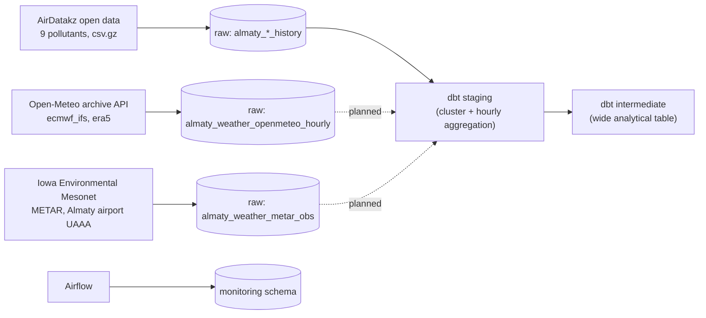

# Climate and Air Quality Data Pipeline — Almaty

## Project Overview

This Data Engineering project collects, consolidates, and transforms weather and air quality data for Almaty, Kazakhstan, from publicly available sources.
It implements an automated, multi-layer ELT pipeline: external sources are loaded into a centralized PostgreSQL database as raw observations, monitored by a dedicated `monitoring` schema, and transformed into analytical datasets with dbt Core.
The pipeline is orchestrated with Apache Airflow 2.10 and runs in a Docker Compose environment.

**Project status: active development.** Raw ingestion and monitoring for all sources are implemented and running; the dbt layers for air quality are implemented; weather integration into dbt and the marts layer are the next steps (see the status table).

## Objectives

- Automate data collection from public weather and air quality sources.
- Keep raw loading reliable: idempotent, incremental, resilient to late-arriving and corrected data, and independent of how often the local machine is switched on.
- Monitor every source: load history, watermarks, data quality checks, freshness, and source health.
- Consolidate multi-station observations into stable geographical clusters, preserving the distribution of values within each cluster (maximum, minimum, mean, median).
- Select weather sources by evidence: compare reanalysis/model data with real airport observations instead of trusting a single provider.
- Design an analytical data model for BI visualization with Apache Superset.

## Technology Stack

- **Python / pandas / psycopg2** — extraction, chunked processing, bulk loading (`COPY`), validation.
- **Apache Airflow 2.10** — orchestration, parameterized DAGs, independent task groups per source.
- **PostgreSQL** — raw, transformed, and monitoring schemas.
- **dbt Core** — layered transformations and automated data tests.
- **Docker Compose** — containerized local environment.
- **Git** — version control.

## Status

| Component | Status |
|---|---|
| Air quality raw ingestion (9 pollutants) | Implemented |
| Open-Meteo weather raw ingestion (two models) | Implemented |
| Airport METAR (UAAA) raw ingestion | Implemented |
| `monitoring` schema: watermarks, load log, data quality results, source coverage | Implemented |
| dbt staging and intermediate layers for air quality | Implemented |
| dbt staging for weather sources | Planned (next) |
| Intermediate integration of air quality with weather | Planned |
| Marts layer (hourly, daily, weather impact) | Planned |
| dbt build triggered from Airflow, `dbt source freshness` | Planned |
| Superset dashboards (including a data quality dashboard) | Planned |

## Pipeline Architecture



### 1. Raw ingestion — Airflow

Each source has its own parameterized DAG with an independent task group per pollutant or model, so a failure in one source does not block the others.

| DAG | Purpose |
|---|---|
| `almaty_air_raw_init` | One-off setup: `monitoring` schema, technical columns, key checks, unique indexes |
| `almaty_air_raw_sync` | Daily update of 9 pollutant tables from `csv.gz` archives |
| `almaty_weather_openmeteo_init` / `_sync` | Hourly weather from Open-Meteo (`ecmwf_ifs`, `era5`) |
| `almaty_weather_metar_init` / `_sync` | Airport observations (METAR) from the Iowa Environmental Mesonet |

Common design principles:

- **Independent watermark.** The loading watermark is stored in `monitoring.etl_watermarks` and reflects the last actually loaded source time — it does not depend on any transformed layer. A weather watermark moves only to the last hour with a real temperature value, so an empty tail of not-yet-published days is never stored.
- **Idempotent loads.** Data is bulk-loaded into a temporary table and merged with `INSERT ... ON CONFLICT` against unique keys, updating only rows that really changed. Re-running a load never creates duplicates.
- **Lookback window.** Each run re-reads the last days (3 for air quality and METAR, 10 for weather reanalysis) to pick up late-arriving or corrected values.
- **Atomic writes.** Data, watermark, load log and quality checks are written in one transaction; a failed load rolls back and is logged separately.
- **Modes.** `incremental` (default) and `full` (complete history). A first load without a watermark loads the full history.
- **Cheap reruns.** Air quality archives are checked with HTTP `ETag`; unchanged files are skipped without downloading.
- **Memory-safe processing.** Files are read in chunks of 100,000 rows; long histories are requested in bounded periods.
- **Schedule built for a laptop.** DAGs run at 16:00 `Asia/Almaty`, shortly after the sources publish (~15:00). With `catchup=False`, a missed run executes once when Docker starts, and watermark-based loading picks up everything accumulated meanwhile.

### 2. Monitoring — `monitoring` schema

Business data is kept separate from technical information about its processing.

| Table | Content |
|---|---|
| `etl_watermarks` | Last successfully loaded source time per source (and ETag where available) |
| `etl_load_log` | One row per load: rows read, rejected, inserted, updated, unchanged, window, status, error |
| `dq_run_results` | One row per quality check: checked and failed counts, status (`pass` / `warn` / `alert` / `skip`), observed value and threshold |
| `source_coverage` | Monthly coverage report for a source (observations, days with data, longest gap) |

Raw-layer quality checks (they record results and do not stop the DAG; invalid values stay in raw and are handled in staging):

- **Air quality:** missing, negative and future values, missing cluster, freshness, anomalous insert volume against the recent median, and **relative lag** — each source is compared with the median of the other live sources, so a single stalled source is detected regardless of weekends or how often the machine runs.
- **Open-Meteo:** value ranges, share of NULLs per variable, expected empty tail, gaps inside the series, hourly jumps, grid cell change, size of revisions against already loaded values, freshness.
- **METAR:** value ranges, NULLs in core fields, missing wind direction at significant wind speed, dew point above temperature, observations per day, gaps between reports, jumps, freshness.

Load-stopping checks (rolled back and logged as `failed`) cover malformed responses, wrong variable sets, non-hourly time steps, duplicate timestamps, timestamps outside the requested range, and an abnormal share of unreadable rows.

### 3. Staging layer — dbt Core (air quality)

- Database views in the `dbt_dev_staging` schema.
- Filters out invalid and incomplete records, including observations with NULL measurement values.
- **Geographical cluster aggregation:** consolidates observations from multiple independent sensors within one cluster.
- **Hourly statistical aggregation:** timestamps are truncated to the hour with `date_trunc`; for each pollutant and cluster the model calculates MAX, MIN, AVG and the median (`percentile_cont(0.5)`, robust to outliers from individual sensors). Keeping the full set of statistics retains the spread of readings inside a cluster and lets the analytical layer distinguish a local spike from cluster-wide pollution.
- Reduces data volume and prevents row multiplication in later joins.

### 4. Intermediate layer — dbt Core (air quality)

- A physical table in the `dbt_dev_intermediate` schema.
- Processes 9 pollutants (PM2.5, PM10, SO2, H2S, NO2, NO, O3, TSP, CO) with Jinja loops into one wide analytical table with four statistics per cluster and hour.
- **Performance:** a join fan-out was resolved by moving aggregation to the staging layer, which reduced the intermediate dataset from an 8 GB join result to a compact table (about 340x, measured before the additional statistics were added).

## Weather Source Selection

The pipeline deliberately keeps two kinds of weather sources **in separate tables and never blends them into one series**: model/reanalysis data (continuous, many variables, but gridded) and real airport observations (one point, but measured). Almaty lies in a basin at the foot of the mountains, so gridded data is not guaranteed to represent it well. The models were compared with airport observations on about 59,000 matching hours (2020 – 2026):

| Model | Temperature bias, °C | Temperature MAE, °C | Wind MAE, m/s | Wind correlation |
|---|---|---|---|---|
| `ecmwf_ifs` | +0.32 | 1.91 | 1.27 | 0.32 |
| `era5` | +0.33 | 2.20 | 1.39 | 0.01 |
| `era5_land` | −1.79 | 2.83 | no data | no data |

Findings:

- `era5_land` returned only temperature and humidity for this request set (all other variables empty over the whole history) and is excluded from scheduled loads.
- `era5` hourly wind shows no skill against observations in any year; it is kept as a reference series with a homogeneous long history.
- `ecmwf_ifs` is the **primary model**: all nine variables are complete from 2020 to the previous day with no gaps. Its accuracy improves over time (temperature MAE about 2.2 °C in 2020 – 2021 vs 1.5 °C in 2026; wind correlation 0.27 vs 0.45) because the underlying model is upgraded periodically, so multi-year trends in weather should not be read from this series.

Collected variables: temperature, relative humidity, wind speed and direction (10 m), precipitation and snowfall (hourly sums), surface pressure, cloud cover, shortwave radiation. Time is stored in UTC.

Airport observations (UAAA) cover 2020-01-01 to the present with about 126,500 observations (reports roughly every 30 minutes) and complete monthly coverage; 26 gaps longer than three hours exist, the longest being about 4 days (October 2022). Values are stored in the source units; unit conversion and hour alignment are planned for the staging and intermediate layers.

## Data Quality and Validation

- **dbt tests:** the combination of `measured_at` and `cluster_id` is unique and not NULL in the air quality model.
- **Raw-layer constraints:** unique keys enforced by PostgreSQL (`datetime_utc` + `station_id` for pollutants, `weather_time` + `model` for Open-Meteo, `station` + `valid` for METAR) and `NOT NULL` key columns.
- **Raw-layer monitoring:** the checks listed above, stored historically in `monitoring.dq_run_results` for a future data quality dashboard.
- **Error separation:** source or API failures, infrastructure failures, data quality violations, completeness problems and transformation errors are distinguished in the load log and check results.

## How to Run the Project

### 1. Start the environment

```bash
docker-compose up -d
docker-compose ps
```

### 2. One-off initialization (Airflow UI, trigger manually)

Trigger `almaty_air_raw_init`, `almaty_weather_openmeteo_init`, and `almaty_weather_metar_init`. The air quality init stops with a report if existing tables contain duplicate keys (parameter `dedupe` removes exact duplicates).

### 3. First load

Trigger `almaty_air_raw_sync`, `almaty_weather_openmeteo_sync`, and `almaty_weather_metar_sync` (the first run without a watermark loads the full history; `mode=full` forces a complete reload). The weather DAGs write a coverage report for the airport source to the task log and to `monitoring.source_coverage`.

### 4. Regular operation

Unpause the sync DAGs. They run daily at 16:00 `Asia/Almaty`. Parameters: `mode` (`incremental` / `full`) and, for subsets, `sources` (pollutants) or `models` (weather models).

### 5. dbt transformations

```bash
# Clean previous dbt build artifacts
dbt clean

# Build staging views (data filtering and hourly aggregation)
dbt run --select path:models/staging

# Build the intermediate analytical table
dbt run --select int_almaty_air_quality

# Run data quality tests
dbt test --select int_almaty_air_quality
```

Make sure the dbt profile is configured to connect to the PostgreSQL database used by the project.

## Known Limitations

- Weather models are gridded data: hourly wind in particular only weakly agrees with measurements; airport observations represent a single point outside the city centre.
- The airport source has a few multi-day gaps (documented in `monitoring.source_coverage`); gaps are not filled.
- The `ecmwf_ifs` series is not homogeneous in accuracy over time (see above).
- Correlation between weather and pollution does not prove causation; seasonality, time of day and emission sources must be considered in analysis.

## Future Development

- **Weather staging and intermediate integration:** staging models for the Open-Meteo and METAR tables (unit conversion, range handling), then joining weather to hourly air quality with a `LEFT JOIN` so pollution measurements are never lost when weather is missing. Wind will be represented as east/north components with a calm flag instead of an averaged direction.
- **Marts layer:** hourly and daily air quality marts and a weather-impact mart, including rolling 24-hour averages and a daily Air Quality Index.
- **Airflow + dbt integration:** run dbt after raw loads complete, with `dbt source freshness` and `dbt build` including tests.
- **BI visualization:** Apache Superset dashboards for air quality and climate trends and for Data Quality Monitoring.
- **Incremental dbt models** with an updated recent-period window for late-arriving data.

## Data Sources and Attribution

- Air quality observations: the open [AirDatakz-OpenData](https://github.com/qazybekb/AirDatakz-OpenData) repository (check the repository for its license terms).
- Weather data: [Open-Meteo.com](https://open-meteo.com/) historical weather API (CC BY 4.0; check the current terms of use).
- Airport observations: METAR archive provided by the [Iowa Environmental Mesonet](https://mesonet.agron.iastate.edu/), Iowa State University.