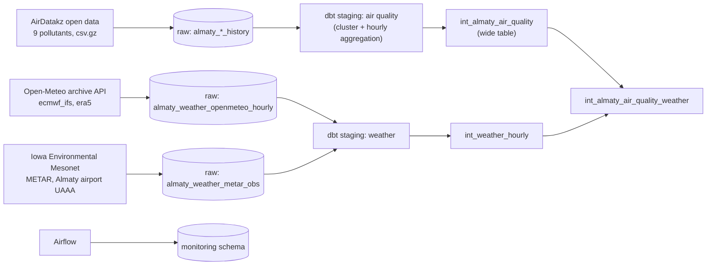

# Climate and Air Quality Data Pipeline — Almaty

## Project Overview

This Data Engineering project collects, consolidates, and transforms weather and air quality data for Almaty, Kazakhstan, from publicly available sources.
It implements an automated, multi-layer ELT pipeline: external sources are loaded into a centralized PostgreSQL database as raw observations, monitored by a dedicated `monitoring` schema, and transformed into analytical datasets with dbt Core.
The pipeline is orchestrated with Apache Airflow 2.10 and runs in a Docker Compose environment.

**Project status: active development.** Raw ingestion and monitoring for all sources are implemented and running; the dbt staging and intermediate layers for air quality and weather, including the integration of air quality with weather, are implemented. The marts layer, dbt runs triggered from Airflow and Superset dashboards are the next steps (see the status table).

## Objectives

- Automate data collection from public weather and air quality sources.
- Keep raw loading reliable: idempotent, incremental, resilient to late-arriving and corrected data, and independent of how often the local machine is switched on.
- Monitor every source: load history, watermarks, data quality checks, freshness, and source health.
- Consolidate multi-station observations into stable geographical clusters, preserving the distribution of values within each cluster (maximum, minimum, mean, median).
- Select weather sources by evidence: compare reanalysis/model data with real airport observations instead of trusting a single provider.
- Design an analytical data model for BI visualization with Apache Superset.

## Technology Stack

- **Python / pandas / psycopg2** — extraction, chunked processing, bulk loading (`COPY`), validation.
- **Apache Airflow 2.10** — orchestration, parameterized DAGs, independent task groups per source.
- **PostgreSQL** — raw, transformed, and monitoring schemas.
- **dbt Core** — layered transformations and automated data tests.
- **Docker Compose** — containerized local environment.
- **Git** — version control.

## Status

| Component | Status |
|---|---|
| Air quality raw ingestion (9 pollutants) | Implemented |
| Open-Meteo weather raw ingestion (two models) | Implemented |
| Airport METAR (UAAA) raw ingestion | Implemented |
| `monitoring` schema: watermarks, load log, data quality results, source coverage | Implemented |
| dbt staging and intermediate layers for air quality (macro-based, with tests) | Implemented |
| dbt staging for weather sources (Open-Meteo, airport METAR) | Implemented |
| Intermediate weather model and integration of air quality with weather | Implemented |
| `dbt source freshness` for raw tables (manual run) | Implemented |
| Marts layer (hourly, daily, weather impact) | Planned |
| dbt build and `dbt source freshness` triggered from Airflow | Planned |
| Superset dashboards (including a data quality dashboard) | Planned |

## Pipeline Architecture



### 1. Raw ingestion — Airflow

Each source has its own parameterized DAG with an independent task group per pollutant or model, so a failure in one source does not block the others.

| DAG | Purpose |
|---|---|
| `almaty_air_raw_init` | One-off setup: `monitoring` schema, technical columns, key checks, unique indexes |
| `almaty_air_raw_sync` | Daily update of 9 pollutant tables from `csv.gz` archives |
| `almaty_weather_openmeteo_init` / `_sync` | Hourly weather from Open-Meteo (`ecmwf_ifs`, `era5`) |
| `almaty_weather_metar_init` / `_sync` | Airport observations (METAR) from the Iowa Environmental Mesonet |

Common design principles:

- **Independent watermark.** The loading watermark is stored in `monitoring.etl_watermarks` and reflects the last actually loaded source time — it does not depend on any transformed layer. A weather watermark moves only to the last hour with a real temperature value, so an empty tail of not-yet-published days is never stored.
- **Idempotent loads.** Data is bulk-loaded into a temporary table and merged with `INSERT ... ON CONFLICT` against unique keys, updating only rows that really changed. Re-running a load never creates duplicates.
- **Lookback window.** Each run re-reads the last days (3 for air quality and METAR, 10 for weather reanalysis) to pick up late-arriving or corrected values.
- **Atomic writes.** Data, watermark, load log and quality checks are written in one transaction; a failed load rolls back and is logged separately.
- **Modes.** `incremental` (default) and `full` (complete history). A first load without a watermark loads the full history.
- **Cheap reruns.** Air quality archives are checked with HTTP `ETag`; unchanged files are skipped without downloading.
- **Memory-safe processing.** Files are read in chunks of 100,000 rows; long histories are requested in bounded periods.
- **Schedule built for a laptop.** DAGs run at 16:00 `Asia/Almaty`, shortly after the sources publish (~15:00). With `catchup=False`, a missed run executes once when Docker starts, and watermark-based loading picks up everything accumulated meanwhile.

### 2. Monitoring — `monitoring` schema

Business data is kept separate from technical information about its processing.

| Table | Content |
|---|---|
| `etl_watermarks` | Last successfully loaded source time per source (and ETag where available) |
| `etl_load_log` | One row per load: rows read, rejected, inserted, updated, unchanged, window, status, error |
| `dq_run_results` | One row per quality check: checked and failed counts, status (`pass` / `warn` / `alert` / `skip`), observed value and threshold |
| `source_coverage` | Monthly coverage report for a source (observations, days with data, longest gap) |

Raw-layer quality checks (they record results and do not stop the DAG; invalid values stay in raw and are handled in staging):

- **Air quality:** missing, negative and future values, missing cluster, freshness, anomalous insert volume against the recent median, and **relative lag** — each source is compared with the median of the other live sources, so a single stalled source is detected regardless of weekends or how often the machine runs.
- **Open-Meteo:** value ranges, share of NULLs per variable, expected empty tail, gaps inside the series, hourly jumps, grid cell change, size of revisions against already loaded values, freshness.
- **METAR:** value ranges, NULLs in core fields, missing wind direction at significant wind speed, dew point above temperature, observations per day, gaps between reports, jumps, freshness.

Load-stopping checks (rolled back and logged as `failed`) cover malformed responses, wrong variable sets, non-hourly time steps, duplicate timestamps, timestamps outside the requested range, and an abnormal share of unreadable rows.

### 3. Staging layer — dbt Core

Layers are configured in `dbt_project.yml`. A custom schema is appended to the target schema, so with target schema `dbt_dev` the layers are built in `dbt_dev_staging`, `dbt_dev_intermediate` and `dbt_dev_marts` (the last one is reserved for the planned marts). By default staging is materialized as views, intermediate and marts as tables; the air quality staging models override this in their own `config` and are tables with a unique index on (`measured_at`, `cluster_id`). The weather model used downstream is set in one place, the variable `primary_weather_model` (`ecmwf_ifs`).

**Air quality** (`models/staging/air_quality/`, materialized as tables with a unique index on the grain):

- One macro, `stg_air_quality_hourly`, builds all nine pollutant models (`stg_almaty_<pollutant>`), so the logic is defined once.
- Records with missing values, a missing cluster, or negative concentrations are dropped before aggregation (the lower bound is the variable `air_quality_min_value`, 0 by default, defined in the macro with `var('air_quality_min_value', 0)`; the value `'none'` keeps every row).
- **Geographical cluster aggregation:** consolidates observations from multiple independent sensors within one cluster.
- **Hourly statistical aggregation:** timestamps are truncated to the hour with `date_trunc`; for each pollutant and cluster the model calculates MAX, MIN, AVG and the median (`percentile_cont(0.5)`, robust to outliers from individual sensors). Keeping the full set of statistics retains the spread of readings inside a cluster and lets the analytical layer distinguish a local spike from cluster-wide pollution.
- `<pollutant>_station_count` and `<pollutant>_reading_count` show how many stations and readings stand behind an hour (a cluster with one station has identical minimum, mean and maximum).

**Weather** (`models/staging/weather/`, views): only renaming, type casting and unit conversion.

- `stg_weather_openmeteo` keeps every loaded model (one row per hour and model) together with the grid cell coordinates and elevation. Only renaming and type casting happen here; the primary model is chosen in the intermediate layer.
- `stg_weather_metar` converts airport reports to SI units, one row per report (not aligned to the hour). Besides temperature, wind and pressure it keeps dew point, relative humidity, gusts, visibility, sea-level pressure, sky cover and cloud base layers, present weather codes, the raw METAR text and station metadata. Physically impossible values (typos in the original reports) become NULL and the row is flagged with `has_invalid_value`; calm and variable wind are flagged (`is_calm`, `is_variable_direction`) instead of dropped. `pressure_qnh_hpa` is the altimeter setting, not station pressure.

### 4. Intermediate layer — dbt Core

Physical tables in the `dbt_dev_intermediate` schema with unique indexes on the grain.

- **`int_almaty_air_quality`:** processes 9 pollutants (PM2.5, PM10, SO2, H2S, NO2, NO, O3, TSP, CO) with Jinja loops into one wide table with four statistics per cluster and hour. The key grid is built by grouping on (hour, cluster), which guarantees one row per grain. **Performance:** a join fan-out was resolved by moving aggregation to the staging layer, which reduced the intermediate dataset from an 8 GB join result to a compact table (about 340x, measured before the additional statistics were added).
- **`int_weather_hourly`:** one row per hour (UTC). Model columns come from a single model selected by the variable `primary_weather_model` (`ecmwf_ifs`); precipitation, snowfall and radiation, which describe the preceding hour in Open-Meteo, are aligned to the hour by taking the row labelled one hour later (`weather_flux_label_offset_hours`). Wind is also given as east/north components with a calm flag. Airport observations are added as separate `obs_*` columns (the nearest report within half an hour, a report without invalid values preferred) and are never mixed with model values.
- **`int_almaty_air_quality_weather`:** air quality joined with the weather of the same hour (`LEFT JOIN`), so measurements are not lost when weather is missing (`has_weather` flag). One weather point serves the whole city.

## Weather Source Selection

The pipeline deliberately keeps two kinds of weather sources **in separate tables and never blends them into one series**: model/reanalysis data (continuous, many variables, but gridded) and real airport observations (one point, but measured). Almaty lies in a basin at the foot of the mountains, so gridded data is not guaranteed to represent it well. The models were compared with airport observations on about 59,000 matching hours (2020 – 2026):

| Model | Temperature bias, °C | Temperature MAE, °C | Wind MAE, m/s | Wind correlation |
|---|---|---|---|---|
| `ecmwf_ifs` | +0.32 | 1.91 | 1.27 | 0.32 |
| `era5` | +0.33 | 2.20 | 1.39 | 0.01 |
| `era5_land` | −1.79 | 2.83 | no data | no data |

Findings:

- `era5_land` returned only temperature and humidity for this request set (all other variables empty over the whole history) and is excluded from scheduled loads.
- `era5` hourly wind shows no skill against observations in any year; it is kept as a reference series with a homogeneous long history.
- `ecmwf_ifs` is the **primary model**: all nine variables are complete from 2020 to the previous day with no gaps. Its accuracy improves over time (temperature MAE about 2.2 °C in 2020 – 2021 vs 1.5 °C in 2026; wind correlation 0.27 vs 0.45) because the underlying model is upgraded periodically, so multi-year trends in weather should not be read from this series.

Collected variables: temperature, relative humidity, wind speed and direction (10 m), precipitation and snowfall (hourly sums), surface pressure, cloud cover, shortwave radiation. Time is stored in UTC.

Airport observations (UAAA) cover 2020-01-01 to the present with about 126,500 observations (reports roughly every 30 minutes) and complete monthly coverage; 26 gaps longer than three hours exist, the longest being about 4 days (October 2022).

## Data Quality and Validation

- **dbt tests** cover every layer: uniqueness of the grain, not-null keys, ranges, timestamps not in the future, consistency of the statistics (minimum <= median <= maximum, mean within the range) and, in the intermediate layer, tests that the joins neither lose nor multiply rows (key coverage, rows per pollutant, rows after the weather join, continuity of the hourly weather series). Generic tests without external packages live in `tests/generic/`. Weather staging is tested for uniqueness of the grain (`measured_at` + `model`, `station` + `observed_at`), accepted models and station, and timestamps not in the future; completeness (`not_null`) is required of the primary model `ecmwf_ifs` only, because `era5_land` has just two variables, and physical range checks run with severity `warn` so they do not stop the build. A separate test, `stg_weather_metar_invalid_values`, lists the METAR reports flagged with `has_invalid_value`: about nine such reports are known (2022 – 2024), so isolated cases are normal; the test warns above 15 and fails above 500, which would point to a parsing problem rather than typos in the source.
- **Source freshness:** `dbt source freshness` checks the `loaded_at` column of the raw tables (closed archives are excluded). It is currently run manually; running it automatically after raw loads is planned.
- **Raw-layer constraints:** unique keys enforced by PostgreSQL (`datetime_utc` + `station_id` for pollutants, `weather_time` + `model` for Open-Meteo, `station` + `valid` for METAR) and `NOT NULL` key columns.
- **Raw-layer monitoring:** the checks listed above, stored historically in `monitoring.dq_run_results` for a future data quality dashboard.
- **Error separation:** source or API failures, infrastructure failures, data quality violations, completeness problems and transformation errors are distinguished in the load log and check results.

## How to Run the Project

### 1. Start the environment

```bash
docker-compose up -d
docker-compose ps
```

### 2. One-off initialization (Airflow UI, trigger manually)

Trigger `almaty_air_raw_init`, `almaty_weather_openmeteo_init`, and `almaty_weather_metar_init`. The air quality init stops with a report if existing tables contain duplicate keys (parameter `dedupe` removes exact duplicates).

### 3. First load

Trigger `almaty_air_raw_sync`, `almaty_weather_openmeteo_sync`, and `almaty_weather_metar_sync` (the first run without a watermark loads the full history; `mode=full` forces a complete reload). The weather DAGs write a coverage report for the airport source to the task log and to `monitoring.source_coverage`.

### 4. Regular operation

Unpause the sync DAGs. They run daily at 16:00 `Asia/Almaty`. Parameters: `mode` (`incremental` / `full`) and, for subsets, `sources` (pollutants) or `models` (weather models).

### 5. dbt transformations

```bash
cd climate_data_dbt

# Build all models and run all tests (staging, intermediate)
dbt build

# Check the freshness of the raw tables
dbt source freshness
```

Useful selections: `dbt build --select staging.air_quality+` (air quality and everything built from it), `dbt build --select staging.weather int_weather_hourly+` (weather). Make sure the dbt profile is configured to connect to the PostgreSQL database used by the project.

## Maintenance

### Rebuilding an air quality raw table from scratch

Use this procedure when the raw data of one pollutant has to be rebuilt: the table is corrupted or inconsistent, rows were removed or restated at the source (regular loads only insert and update rows, they never delete), or a change of the key or schema requires a clean reload. It replaces the former per-pollutant full-load DAGs that truncated and refilled a table on every run.

Source names equal pollutant codes (`pm25`, `pm10`, `no2`, `no`, `so2`, `co`, `o3`, `h2s`, `tsp`); the table is `public.almaty_<code>_history`. The example below rebuilds `pm25`.

**1. Make sure `almaty_air_raw_sync` is not running** (check the Grid view in the Airflow UI). Do not pause the DAG: a manual run of a paused DAG does not execute.

**2. Reset the table and its watermark in a single transaction:**

```sql
BEGIN;
TRUNCATE TABLE public.almaty_pm25_history;
DELETE FROM monitoring.etl_watermarks WHERE source_name = 'pm25';
COMMIT;
```

**3. Trigger `almaty_air_raw_sync` with config** (Airflow UI: *Trigger DAG w/ config*):

```json
{"mode": "full", "sources": ["pm25"]}
```

**4. Verify the result:**

```sql
-- the last load of this source: status 'success', mode 'full', rows_inserted close to rows_read
SELECT status, mode, rows_read, rows_inserted, rows_unchanged
FROM monitoring.etl_load_log
WHERE source_name = 'pm25'
ORDER BY log_id DESC
LIMIT 1;

-- the table content and the restored watermark
SELECT COUNT(*), MIN(datetime_utc), MAX(datetime_utc) FROM public.almaty_pm25_history;
SELECT * FROM monitoring.etl_watermarks WHERE source_name = 'pm25';
```

**5. Refresh the dbt layers.** The air quality staging models and the intermediate models are physical tables, so none of them updates on its own after the raw table is rebuilt. Rebuild the staging model of this pollutant and everything built from it: `dbt build --select stg_almaty_pm25+` (this also rebuilds `int_almaty_air_quality` and `int_almaty_air_quality_weather` and runs their tests). The weather staging models are views and need no rebuild.

Technical notes:

- **Why the watermark is deleted.** An incremental run reads only records newer than the watermark minus the lookback window. If the table were truncated but the old watermark kept, a failed or skipped full load would leave only the most recent days in the table, silently and without any error. Deleting the watermark in the same transaction as `TRUNCATE` guarantees that any following run, manual or scheduled, reloads the full history until a successful load sets a new watermark. The delete also drops the stored HTTP `ETag`, so the archive is downloaded again. (`mode=full` ignores the watermark and the `ETag` on its own; the deletion makes the procedure safe even if the full run fails or is replaced by a scheduled run.)
- **Use `TRUNCATE`, not `DROP TABLE`.** `TRUNCATE` keeps the unique index, `NOT NULL` constraints and technical columns (`load_run_id`, `loaded_at`). If a table was dropped, run `almaty_air_raw_init` first to recreate it.
- **History is preserved.** Previous rows in `monitoring.etl_load_log` and `monitoring.dq_run_results` stay. While the watermark is missing, the `relative_lag_hours` check for this source is recorded as `skip`.

## Known Limitations

- Weather models are gridded data: hourly wind in particular only weakly agrees with measurements; airport observations represent a single point outside the city centre.
- Airport pressure (`pressure_qnh_hpa`, altimeter setting) and model `surface_pressure_hpa` (pressure at the grid point surface) are different quantities and must not be compared directly.
- The airport source has a few multi-day gaps (documented in `monitoring.source_coverage`); gaps are not filled.
- The `ecmwf_ifs` series is not homogeneous in accuracy over time (see above).
- About nine airport reports (2022 – 2024) contain typos in the original METAR text (for example a truncated pressure group or a wind of 81 m/s). They are not deleted: the impossible value becomes NULL in staging and the row is flagged.
- Weather values for an air quality hour assume that the air quality timestamp marks the start of the hour; if the source documents otherwise, the alignment is changed with the variable `weather_flux_label_offset_hours`.
- One weather point serves the whole city, so clusters of the same hour share the same weather.
- Correlation between weather and pollution does not prove causation; seasonality, time of day and emission sources must be considered in analysis.

## Future Development

- **Marts layer:** hourly and daily air quality marts and a weather-impact mart, including rolling 24-hour averages and a daily Air Quality Index.
- **Airflow + dbt integration:** run dbt after raw loads complete, with `dbt source freshness` and `dbt build` including tests.
- **BI visualization:** Apache Superset dashboards for air quality and climate trends and for Data Quality Monitoring.
- **A long-format integration model** (one row per hour, cluster and pollutant) as the main intermediate model, with the wide table built from it.
- **Incremental dbt models** with an updated recent-period window for late-arriving data.

## Data Sources and Attribution

- Air quality observations: the open [AirDatakz-OpenData](https://github.com/qazybekb/AirDatakz-OpenData) repository (check the repository for its license terms).
- Weather data: [Open-Meteo.com](https://open-meteo.com/) historical weather API (CC BY 4.0; check the current terms of use).
- Airport observations: METAR archive provided by the [Iowa Environmental Mesonet](https://mesonet.agron.iastate.edu/), Iowa State University.